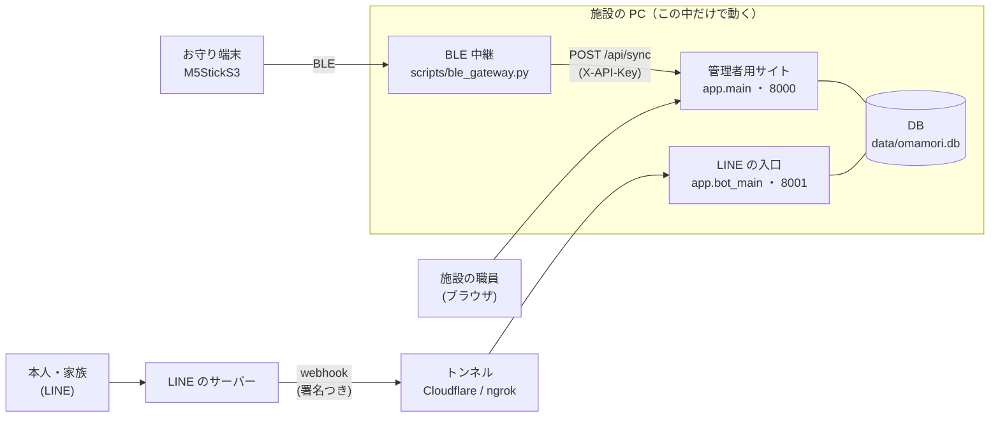
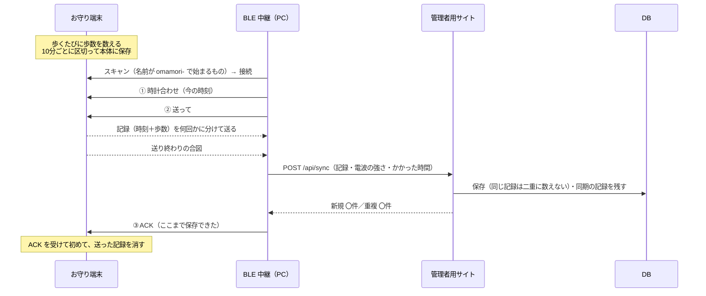
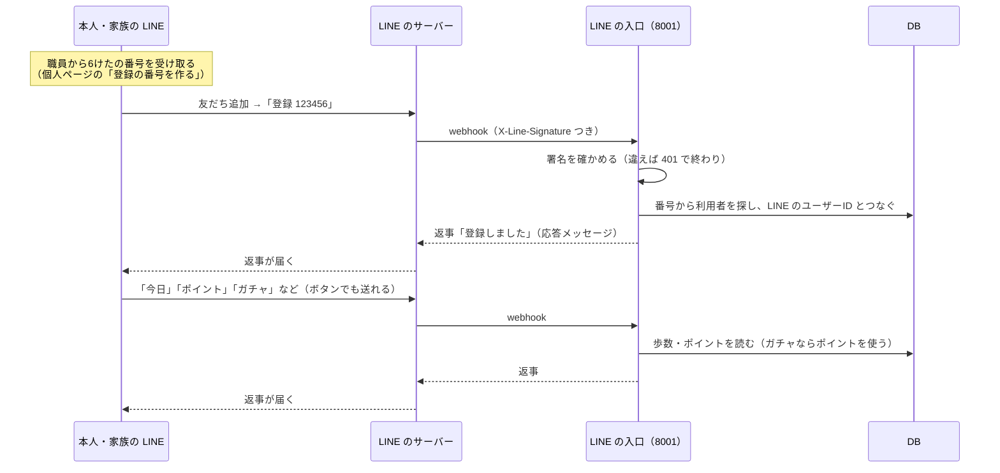

# 起動のしかたと、動作のしくみ

お守り型歩数計の試作システムを「どう起動するか」と「中で何が起きているか」をまとめたものです。
細かいコマンドの説明は [README](../README.md)、BLE の決まりは [ble_protocol.md](ble_protocol.md)、端末のプログラムは [firmware/README.md](../firmware/README.md) を見てください。

---

## 1. 全体の形



| 部品 | 何をするか | 場所 | 起動 |
|---|---|---|---|
| お守り端末 | 歩数を数えて、10分ごとに本体に記録する | `firmware/omamori_m5/` | M5StickS3 に書き込む（コンパイルは確認ずみ、**実機確認はまだ**。手順は [firmware/README.md](../firmware/README.md)） |
| BLE 中継 | 近くの端末と BLE でつながり、記録を受け取ってサーバーに送る | `scripts/ble_gateway.py` | PowerShell で実行 |
| 管理者用サイト | 歩数を保存し、職員が見る画面を出す | `app/main.py`（ポート 8000） | PowerShell で実行 |
| LINE の入口 | 本人・家族の LINE からのことばに返事をする | `app/bot_main.py`（ポート 8001） | PowerShell で実行（LINE を使うときだけ） |
| トンネル | LINE のサーバーから 8001 に届くようにする | Cloudflare Tunnel か ngrok | PowerShell で実行（LINE を使うときだけ） |
| DB | すべてのデータ（SQLite の1つのファイル） | `data/omamori.db` | 自動で作られる |

**インターネットに出るのはトンネルを通した 8001 だけ**です。管理者用サイト（8000）と `/api/sync` は、この PC の中からしか開けません。

---

## 2. 起動のしかた

### 2-1. 最初に1回だけ

PowerShell で `PD実践` のフォルダを開いて実行します。

```powershell
python -m venv .venv
```

```powershell
.\.venv\Scripts\python.exe -m pip install -r requirements-dev.txt
```

```powershell
if (Test-Path .env) { "もう .env があるので、コピーしませんでした" } else { Copy-Item .env.example .env; ".env を作りました。中に値を入れてください" }
```

`.env` に入れるもの:

| 名前 | 中身 | 必要なとき |
|---|---|---|
| `ADMIN_PASSWORD` | 管理者用サイトのパスワード（チームで決める） | いつも |
| `SYNC_API_KEY` | BLE 中継がサーバーに送るときのキー（下のコマンドで作る） | いつも |
| `SESSION_SECRET` | ログイン状態の署名用（下のコマンドで作る） | いつも（空でも動く） |
| `LINE_CHANNEL_SECRET` | LINE のチャネルシークレット | LINE を使うとき |
| `LINE_CHANNEL_ACCESS_TOKEN` | LINE のチャネルアクセストークン（長期） | LINE を使うとき |
| `LINE_DRY_RUN` | `1` にすると、LINE に送らずに試す | LINE なしで試すとき |

```powershell
.\.venv\Scripts\python.exe -c "import secrets; print(secrets.token_hex(32))"
```

BLE 中継を使う PC では、BLE 用のライブラリも入れます。

```powershell
.\.venv\Scripts\python.exe -m pip install -r requirements-ble.txt
```

### 2-2. 毎回の起動（PowerShell を用途ごとに開く）

| 順番 | 何を動かすか | コマンド | 止め方 |
|---|---|---|---|
| ① | 管理者用サイト | `.\.venv\Scripts\python.exe -m uvicorn app.main:app` | Ctrl+C |
| ② | BLE 中継（端末があるとき） | `.\.venv\Scripts\python.exe scripts\ble_gateway.py` | Ctrl+C |
| ③ | LINE の入口（LINE を使うとき） | `.\.venv\Scripts\python.exe -m uvicorn app.bot_main:app --port 8001` | Ctrl+C |
| ④ | トンネル（LINE を使うとき） | `cloudflared tunnel --url http://127.0.0.1:8001` | Ctrl+C |

- ① を起動したら、ブラウザで http://127.0.0.1:8000 を開き、`ADMIN_PASSWORD` でログインします。
- ② は5分ごとに端末を探して同期します。1回だけなら `--once` を付けます。
- ④ の Cloudflare の試し用トンネルは、起動するたびに URL（`https://〇〇.trycloudflare.com`）が変わります。
  LINE Developers の Webhook URL を `https://〇〇.trycloudflare.com/line/webhook` に入れ直してください。

### 2-3. 端末や LINE がなくても試す

| 試したいこと | 使うもの | コマンド |
|---|---|---|
| 画面にデータを出す | ダミーデータ（5人・14日分） | `.\.venv\Scripts\python.exe scripts\seed.py` |
| 歩数が届くところ | にせタブレット（① を起動しておく） | `.\.venv\Scripts\python.exe scripts\fake_tablet.py` |
| LINE のやりとり | にせ LINE（`.env` に `LINE_DRY_RUN=1` と試し用の `LINE_CHANNEL_SECRET` を入れ、③ を起動しておく） | `.\.venv\Scripts\python.exe scripts\fake_line.py "登録 123456"` |
| 全部まとめて | 自動テスト（一時フォルダの DB を使う） | `.\.venv\Scripts\python.exe -m pytest` |

---

## 3. 動作のしくみ

### 3-1. 歩数が数えられて、サーバーに届くまで



**歩数の数え方（端末）**
- 加速度センサーの揺れの「山」を数えます。一定のリズムで4歩続いてから数え始めるので、たまたまの揺れは数えません。
- 10分ごとに区切って1件の記録にします（歩いていない時間帯は記録しない）。電源が切れても残ります。最大 432 件。
- 時計は PC と同期したときに合います。合う前の記録は、同期したときに本当の時刻に直します。

**データが失われない・二重にならないしくみ**
- 端末は、サーバーに保存できたという ACK が来るまで記録を消しません。途中で切れても、次の同期でもう一度送ります。
- サーバーは「端末 ID ＋ 測った時刻」が同じ記録を二重に保存しません（`UNIQUE(device_id, measured_at)`）。何度届いても歩数は増えません。
- 登録していない端末から届いたデータも保存し、端末は「持ち主なし」で登録します。あとで持ち主を決めると、それまでの記録もその人のものになります。
- 端末の時計がおかしい記録（2024年より前・今より10分以上先）は保存しません。

**同期の記録（BLE の検証用）**
- 同期のたびに、成功・失敗、電波の強さ（RSSI）、かかった時間（ミリ秒まで）、メモ（例: `--note "距離3m"`）を残します。
- 端末が見つからなかったときも、`--expect omamori-01` を付けておけば「失敗」として残ります。
- 「同期記録」の画面と CSV で、端末ごとの成功率や平均の時間を見られます。

### 3-2. 管理者用サイトで見られるもの

| 画面 | 中身 |
|---|---|
| 利用者一覧 `/` | 今日の歩数・目標・達成率・アラート・最後に同期した時刻。1分ごとに自動で更新 |
| 個人ページ `/users/{id}` | 日別歩数のグラフ（目標の線・過負荷の目安の線）、直近の同期、ポイント・ガチャ、LINE の登録の番号 |
| 登録・編集 `/manage` | 利用者（ニックネーム・開始前の平均歩数）と端末の登録 |
| 同期記録 `/sync-logs` | BLE 検証用のまとめと一覧 |
| 設定 `/settings` | アラートのしきい値、ポイント・ガチャのルール |
| CSV `/export` | 日別歩数（ポイントつき）・細かい記録・同期記録・ガチャ |

- **目標** ＝ 開始前の1日平均歩数 ＋ 1,500歩
- **日別の歩数** ＝ その日（日本時間）に届いた記録の歩数の合計
- **過負荷アラート**: 今日の歩数が目標の 150% 以上（仮の値）
- **未同期アラート**: 24時間データが届いていない（仮の値。0 で止める）

### 3-3. LINE（本人用）



**送ることば**: `登録 123456`・`今日`・`1週間`・`1か月`・`ポイント`・`ガチャ`・`目標`・`解除`（全角でもよい。知らないことばには使い方を返す）

**ポイント**（設定画面で変えられる）
- 1,000歩で 1pt、その日の目標を達成したら +2pt、ガチャ1回 10pt
- 目標の 150% を超えた分の歩数はポイントにしない（歩きすぎをすすめないため）
- ポイントは保存せず、歩数の記録から毎回計算します（あとから届いた歩数もすぐ反映。ルールを変えると、これまでの分も計算し直し）
- 使えるポイント ＝ もらったポイントの合計 − ガチャで使ったポイントの合計（マイナスにはしない）

**ガチャ**: まずレア度を 60%／30%／10% で決め、その中のメッセージを1つ選びます（前の omamori-bot のメッセージ8つ）。家族が同時に回しても、ポイントを使いすぎないようにしてあります。

**登録まわり**
- 同じ番号で家族も登録できます。1つの LINE は1人の利用者とだけつながります。
- 番号を作り直すと、前の番号は使えなくなります（登録ずみの LINE はそのまま）。
- LINE で「解除」と送るか、ブロックされると、その LINE のつながりは消えます。職員も個人ページから解除できます。
- 番号を5回まちがえた LINE からは、1時間受けつけません。
- LINE が同じイベントを送り直してきても、ガチャを2回回さないようにしています。
- グループのトークには対応していません（1対1のトークで使う）。

### 3-4. 安全のしくみ

| どこ | しくみ |
|---|---|
| 管理者用サイト | 共通パスワードでログイン（12時間）。この PC の中からしか開けない |
| `/api/sync` | `X-API-Key`（`.env` の `SYNC_API_KEY`）がないと受けつけない |
| LINE の入口 | LINE の署名がないものは受けつけない。画面や API は置いていない。1MB より大きいものは読まない |
| パスワード・キー | `.env` にだけ置く（Git に入れない） |
| 個人情報 | ニックネームだけを使う。LINE に送るのはニックネーム・歩数・ポイント・ガチャのメッセージだけ。DB に LINE のユーザーID が入る（プロフィールは取らない） |
| BLE | ペアリングなし（試作のため）。近くの人が接続すると、記録を読める・消せる |

### 3-5. データ（DB の表）

| 表 | 中身 |
|---|---|
| `users` | 利用者（ニックネーム・開始前の平均・目標） |
| `devices` | 端末（端末 ID・持ち主・最後に同期した時刻） |
| `step_records` | 歩数の記録（端末・持ち主・測った時刻・歩数） |
| `sync_logs` | 同期の記録（成功・失敗・RSSI・時間・メモ） |
| `settings` | しきい値・ポイントのルール |
| `line_link_codes` | 登録の番号 |
| `line_links` | LINE のアカウントと利用者のつながり |
| `gacha_draws` | ガチャの記録 |
| `line_events` | LINE の送り直しを見分けるための ID（7日で消す） |

---

## 4. まだできていないこと・確かめていないこと

- お守り端末のプログラムの、実機での確認（コンパイルは 2026-10-14 に確認ずみ）
- 本物の端末との BLE 同期
- 本物の LINE・トンネルを通したやりとり（にせ LINE では確かめた）
- 歩数の数え方の調整（100歩テスト）、電池の持ち

授業のルールにより、生成AIが書いたコードはチーム全員でレビューし、佐野先生に報告してから使ってください（`docs/review/`）。
